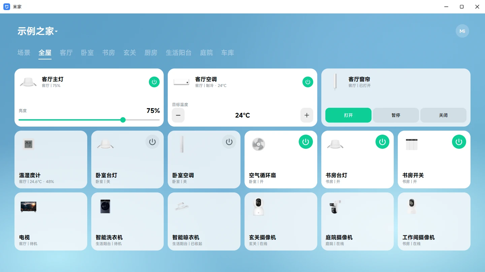
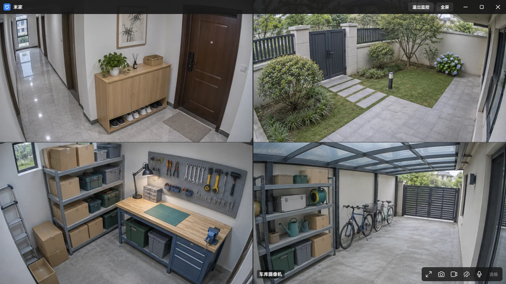

<h1 align="center">米家 Desktop</h1>

<p align="center">在 Windows 上控制米家设备、固定桌面卡片、查看多路监控。</p>

<p align="center">
  <a href="https://github.com/ALittlePandaMan/mijia-desktop/releases/latest"></a>
  <a href="https://github.com/ALittlePandaMan/mijia-desktop/releases"></a>
</p>

<p align="center">
  <a href="https://github.com/ALittlePandaMan/mijia-desktop/releases/latest"><strong>下载 Windows 版</strong></a> ·
  <a href="https://alittlepandaman.github.io/mijia-desktop/">官网</a> ·
  <a href="docs/MCP.md">MCP 指南</a> ·
  <a href="https://github.com/ALittlePandaMan/mijia-desktop/issues">反馈</a>
</p>

> [!NOTE]
> 正式版支持 **Windows 10 / 11（x64）**，运行需要 Microsoft Edge WebView2 Runtime。



## 核心功能

- **设备管理**可按家庭和房间查看设备、读数和详情，也可直接通过卡片控制设备。卡片可以拖动排序；支持额外快捷项或读数的型号可设为大卡片。
- **桌面卡片**可按显示器独立启用，分别设置栅格、留白和布局。[桌面卡片指南](docs/DESKTOP_WIDGETS.md)
- **多路监控**可全屏查看当前家庭或多个家庭的摄像机。支持的型号还可回看、对讲、截图和录像。[视频播放与兼容性](docs/VIDEO_PLAYBACK.md)
- **智能家居 MCP**可让兼容的 AI 助手控制设备、查询读数或启动场景。设备匹配和操作由米家云端处理。[MCP 接入说明](docs/MCP.md)

### 多路摄像机监控



截图使用模拟设备与合成监控画面。

## 下载与使用

发布页提供 Windows x64 安装版与便携版。[最新 Release](https://github.com/ALittlePandaMan/mijia-desktop/releases/latest)

- **安装版**（`.exe`）运行安装程序，缺少 WebView2 时会引导安装。
- **便携版**（`.zip`）完整解压，再运行目录中的 `mijia-desktop.exe`。

用手机上的米家 App 扫码确认登录，再选择家庭。设备功能取决于型号、固件和账号权限。[平台支持与数据说明](docs/PLATFORMS.md) · [应用内更新](docs/APP_UPDATES.md)

[设备适配与开发者模式](docs/DEVICE_COVERAGE.md)

## 从源码运行

[](https://github.com/ALittlePandaMan/mijia-desktop/actions/workflows/ci.yml)

客户端基于 Tauri 2、Rust 和 TypeScript。安装 Git、Node.js、Rust 及 [Tauri 系统依赖](https://v2.tauri.app/start/prerequisites/)后，运行以下命令启动开发客户端。

```bash
git clone https://github.com/ALittlePandaMan/mijia-desktop.git
cd mijia-desktop
npm ci
npm run tauri -- dev
```

## 反馈与许可

查看 [更新日志](CHANGELOG.md)，或在 [GitHub Issues](https://github.com/ALittlePandaMan/mijia-desktop/issues) 提交版本号、系统版本和脱敏后的复现步骤。

米家 Desktop 是独立第三方客户端，与小米或米家无隶属关系。原创代码采用 [MIT 许可](LICENSE)。第三方素材、字体及依赖遵循各自许可，详见 [第三方声明](docs/THIRD_PARTY_NOTICES.md)。
